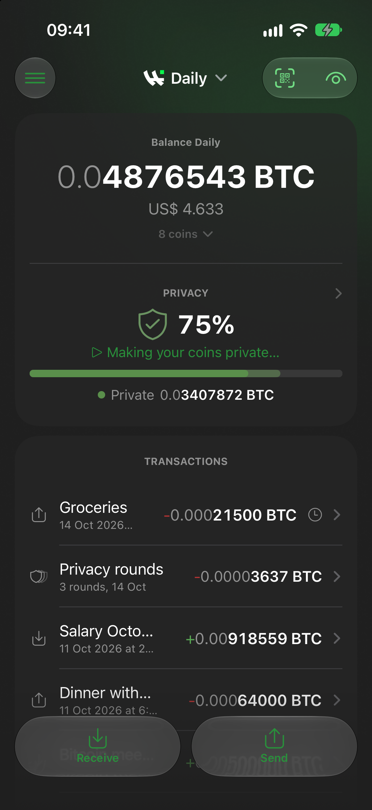
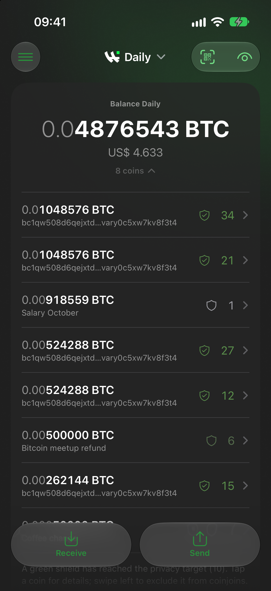
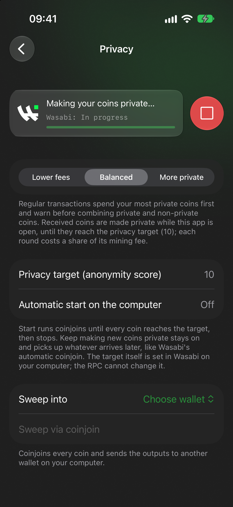
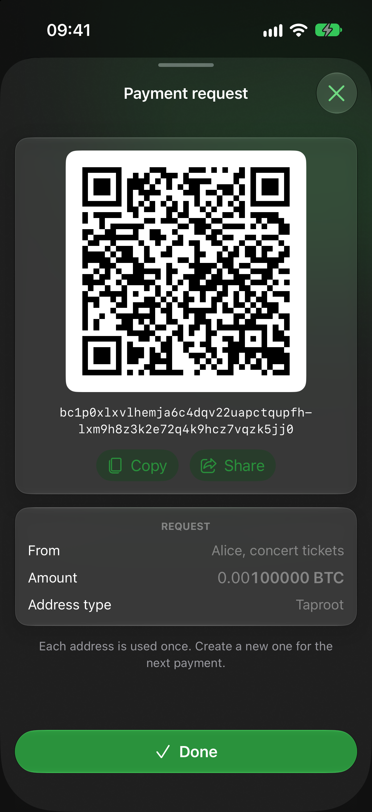
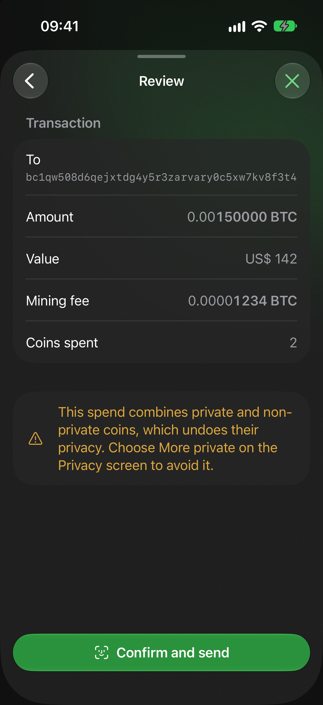
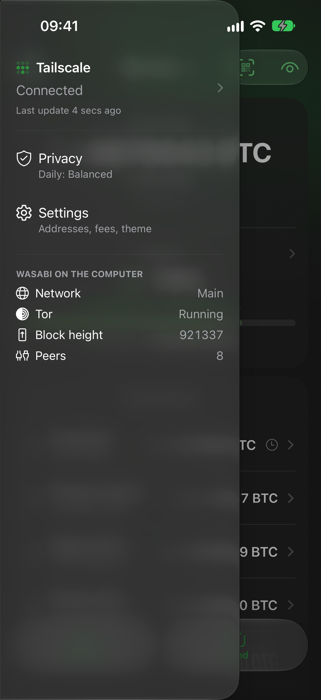

# Wasabi Preview Mobile

Native iOS and Android companion for a desktop Wasabi Wallet: balance, privacy, transactions, receive, send (QR, BIP 321) and
coinjoin control over Wasabi's JSON-RPC, reached through Tailscale or a client-authorized Tor onion service (Arti
embedded in the app).

<p align="center">
  
  
  
  
  
  
</p>

## Install

- **iPhone** (iOS 26 or newer): join the [TestFlight beta](https://testflight.apple.com/join/bvMRTbGz), or sideload the
  `.ipa` from [GitHub releases](https://github.com/kravens/coinjoin.nl/releases).
- **Android / GrapheneOS**: [Zapstore](https://zapstore.dev/apps/nl.kravens.wasabipreview), or the APK from
  [GitHub releases](https://github.com/kravens/coinjoin.nl/releases). No Google Play services needed.

No computer with Wasabi at hand? "Try the demo wallet" on the connection screen shows the app with sample data.

## Build

Needs Xcode 27+, [XcodeGen](https://github.com/yonaskolb/XcodeGen) and Rust (rustup with the iOS targets).

```sh
tor/build.sh            # Arti (Rust) -> tor/WasabiTor.xcframework
xcodegen generate
open WasabiPreview.xcodeproj
```

Set your own `DEVELOPMENT_TEAM` in `project.yml` to sign for your device.

## Android

`android/` is the same app for Android, GrapheneOS and (through Waydroid) Omarchy Mobile: Kotlin and Jetpack Compose,
with the same Arti bridge from `tor/` loaded over JNI. Few dependencies on purpose: Compose, CameraX and ZXing for QR
codes. HTTP, JSON, the Android Keystore (connection settings, encrypted), biometrics and network monitoring come from
the platform, and nothing needs Google Play services. `android/build.sh` builds `libwasabitor.so` and the APK and runs
the unit tests (the iOS self-check vectors: BIP 173/350/321, coin selection, privacy percentage, fee choices).

Debug builds take the same screenshot hooks as the iOS simulator, as intent extras:
`adb shell am start -n nl.kravens.wasabipreview/.MainActivity --ez demo true --es screen sendReview`.

Release builds are signed with `~/.config/wasabi-mobile/release.p12` when it exists (its password in the macOS
Keychain as `wasabi-mobile-release`), otherwise with the debug key. `android/zapstore.yaml` is the Zapstore listing:
after `android/build.sh`, run `zsp publish` in `android/`.

## Desktop side

`desktop/wasabi-remote.sh` does all of this on macOS (Homebrew tor) or Arch/Omarchy (pacman tor): quit Wasabi, run it,
and enter the values it writes to `~/.config/wasabi-remote/phone.txt` in the app. It can be run again safely.

By hand: in `~/.walletwasabi/client/Config.json`: `JsonRpcServerEnabled: true`, a `JsonRpcUser`/`JsonRpcPassword`, and
`JsonRpcServerPrefixes` with `http://127.0.0.1:37128/` plus the computer's Tailscale IP. For Tor, run a separate tor
with `HiddenServicePort 80 127.0.0.1:37128` and client authorization; the phone gets the x25519 private key.

The RPC login can move funds. The app only accepts Tailscale addresses or a Tor onion, and only calls the methods in
`WasabiRPC.allowed`.
