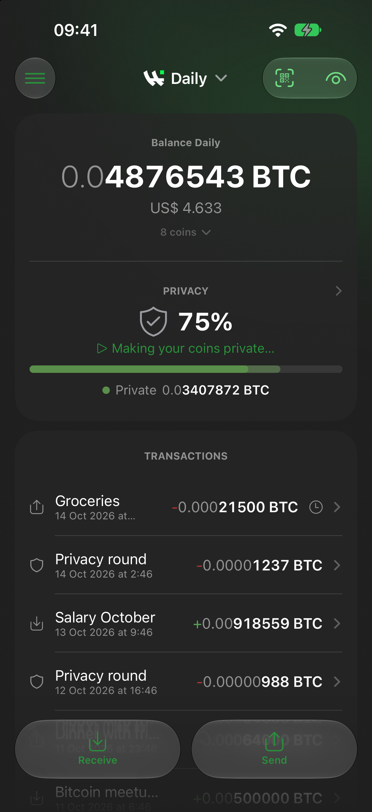
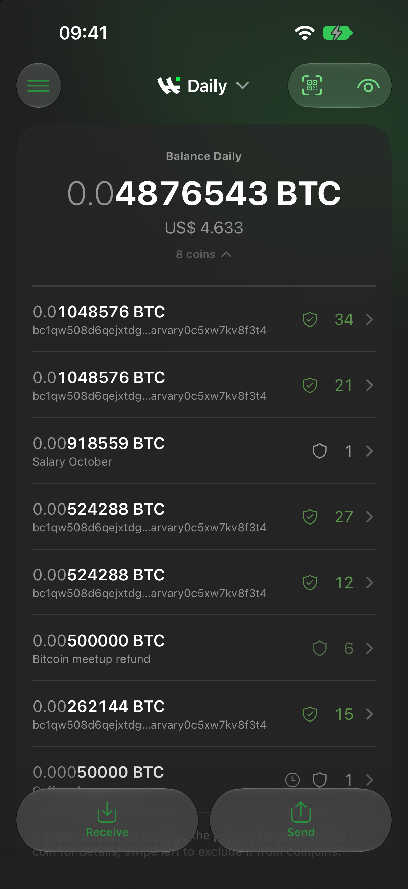
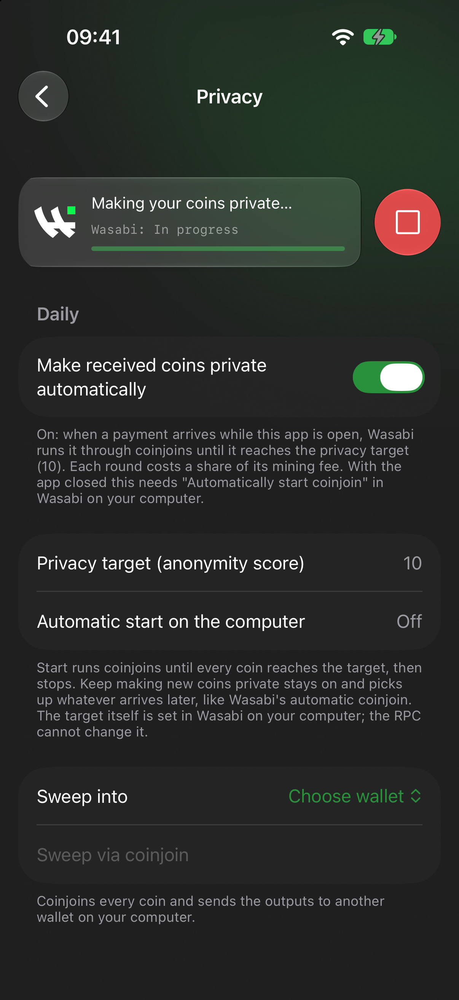
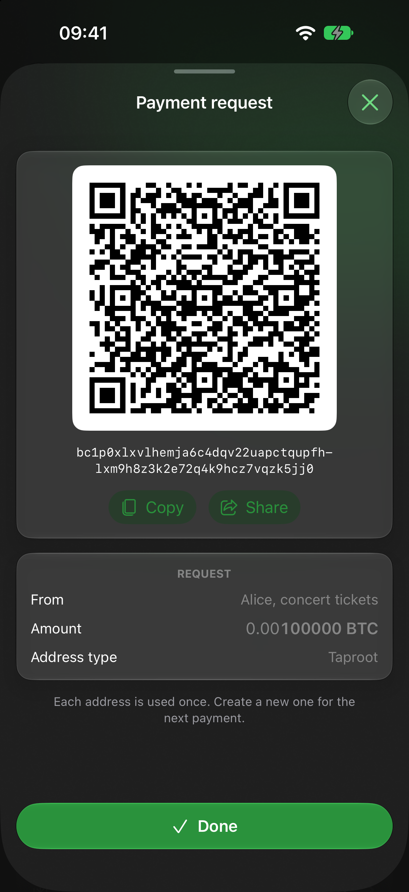
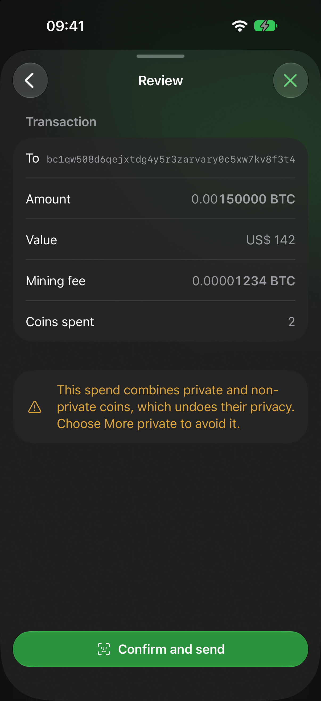
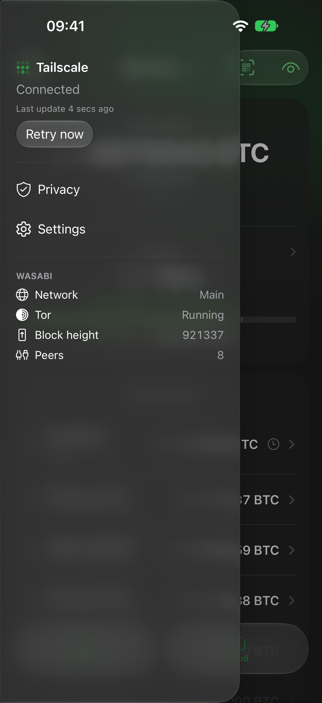

# Wasabi Preview Mobile

Native iOS companion for a desktop Wasabi Wallet: balance, privacy, transactions, receive, send (QR, BIP 321) and
coinjoin control over Wasabi's JSON-RPC, reached through Tailscale or a client-authorized Tor onion service (Arti
embedded in the app).

<p align="center">
  
  
  
  
  
  
</p>

## Build

Needs Xcode 27+, [XcodeGen](https://github.com/yonaskolb/XcodeGen) and Rust (rustup with the iOS targets).

```sh
tor/build.sh            # Arti (Rust) -> tor/WasabiTor.xcframework
xcodegen generate
open WasabiPreview.xcodeproj
```

Set your own `DEVELOPMENT_TEAM` in `project.yml` to sign for your device.

## Desktop side

In `~/.walletwasabi/client/Config.json`: `JsonRpcServerEnabled: true`, a `JsonRpcUser`/`JsonRpcPassword`, and
`JsonRpcServerPrefixes` with `http://127.0.0.1:37128/` plus the computer's Tailscale IP. For Tor, run a separate tor
with `HiddenServicePort 80 127.0.0.1:37128` and client authorization; the phone gets the x25519 private key.

The RPC login can move funds. The app only accepts Tailscale addresses or a Tor onion, and only calls the methods in
`WasabiRPC.allowed`.
